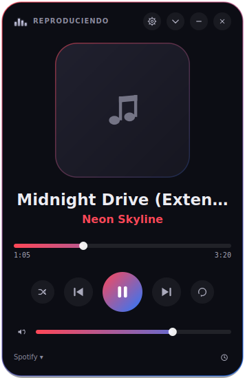
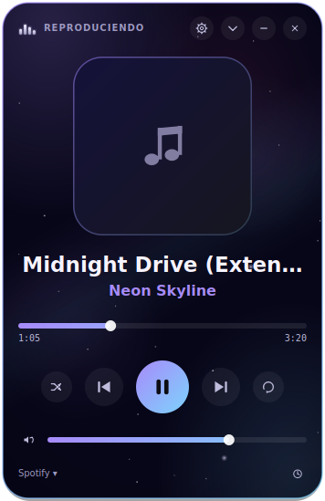
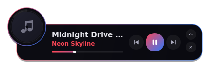
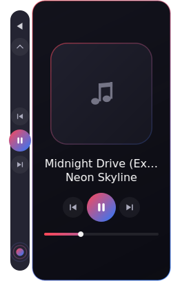

<div align="center">

# WNP Player

**Reproductor de escritorio para Windows que muestra y controla lo que suena en tu navegador y en Spotify.**

Hecho con PyQt6 · Creado por **[YefriDev](https://github.com/Yeflix)**


 

</div>

---

## ¿Qué es?

WNP Player **no reproduce audio por sí mismo**: lee el estado de lo que ya suena (título, artista, carátula, posición, volumen) y le manda órdenes (play/pausa, siguiente, anterior, buscar, volumen, aleatorio, repetir).

| Fuente | Cómo se conecta |
|---|---|
| YouTube, YouTube Music, Spotify Web, SoundCloud, Deezer… | Extensión **WebNowPlaying** del navegador |
| Apps de escritorio de Windows (Spotify, etc.) | Sesiones multimedia de Windows (SMTC) |

## Características

- **Tres modos de ventana:** completa, compacta (barra con vinilo) y panel lateral anclado al borde de la pantalla (estilo tarjeta o compacto).
- **Letras** sincronizadas desde [lrclib.net](https://lrclib.net), con limpieza de títulos de YouTube y botón de recarga.
- **Botón "me gusta"** para Spotify y YouTube (con tus propias credenciales de desarrollador).
- **Historial, estadísticas y resumen semanal** guardados solo en tu equipo.
- **Scrobbling** a Last.fm o ListenBrainz (opcional).
- **Filtro de anuncios de Spotify:** no ensucian el historial ni las estadísticas.
- **Teclas globales**, bandeja del sistema y notificaciones.
- **Dos aspectos:** predeterminado y *Cosmos*; accesibilidad (tamaño de letra, alto contraste, reducir movimiento) y escala automática según la resolución.
- Si no hay ningún reproductor abierto, pulsar **play** abre Spotify o YouTube.

<details>
<summary>Más capturas</summary>

<br>
 

</details>

## Requisitos

- Windows 10/11 (en Linux y macOS arranca, pero sin apps de escritorio ni teclas globales).
- Python 3.10 o superior.
- La extensión **WebNowPlaying** en tu navegador, con el *adaptador personalizado* apuntando a `localhost:1234`.

## Instalación

```bash
git clone https://github.com/TU-USUARIO/wnp-player.git
cd wnp-player
pip install -r requirements.txt
python main.py                 # usa el puerto de la última sesión (por defecto 1234)
python main.py --port 5678     # fija otro puerto
```

La primera vez aparece un asistente de bienvenida de 4 pasos.

### Crear un ejecutable (.exe)

```bash
pip install pyinstaller
pyinstaller main.spec
```

## Privacidad y seguridad

- El servidor de la extensión y el puente del tema de Spotify escuchan **solo en `127.0.0.1`**.
- Tus datos se guardan en `%LOCALAPPDATA%\WNPPlayer` (configuración, historial, registro de anuncios). **Nada de eso forma parte de este repositorio.**
- `config.json` guarda **en texto plano** las claves y tokens que tú configures (Spotify, Google, Last.fm, ListenBrainz). No lo compartas ni lo subas a ningún sitio.
- Esto es lo único que sale de tu equipo, y solo si activas cada función: artista/título/álbum/duración a lrclib.net (letras); lo que escuchas a Last.fm/ListenBrainz (scrobbling); la autorización a Spotify/Google (me gusta).
- Las credenciales del botón "me gusta" son **de tu propia app** de desarrollador (developer.spotify.com / Google Cloud); este proyecto no incluye ninguna.

## "Me gusta" en Spotify y YouTube

Se configura en **Configuración → Cuentas para «Me gusta»…**

- **Spotify:** crea una app en [developer.spotify.com](https://developer.spotify.com/dashboard), añade `http://127.0.0.1:8898/callback` como *Redirect URI* y pega el *Client ID*. El dueño de la app necesita Premium.
- **YouTube:** proyecto de Google Cloud con YouTube Data API v3, cliente OAuth de tipo "Aplicación de escritorio" y pantalla de consentimiento publicada.

## Spicetify AutoFix (opcional, solo Windows)

La carpeta [`SpicetifyAutoFix/`](SpicetifyAutoFix/) contiene una tarea programada que reaplica [Spicetify](https://spicetify.app) cuando Spotify se actualiza, sin ventanas. Es independiente del reproductor y no hace falta para usarlo. Léela antes de instalarla: compila un pequeño lanzador y crea una tarea en tu equipo ([guía](SpicetifyAutoFix/LEEME.md)).

## Estructura

```
main.py                 punto de entrada
app_controller.py       coordina backend, ventanas y servicios
backend.py              conexión con pywnp y estado del reproductor
pywnp_patch.py          correcciones de pywnp 2.0.2 en memoria
main_window.py          ventana completa
mini_window.py          ventana compacta
dock_window.py          panel lateral
widgets.py, theme.py    componentes y aspecto
lyrics.py, likes.py     letras y "me gusta"
tests/                  pruebas (scripts independientes)
tools/                  diagnósticos y userscript de YouTube
docs/                   documentación completa
```

Documentación técnica completa: [`docs/DOCUMENTACION.md`](docs/DOCUMENTACION.md).

## Pruebas

Son scripts independientes que se ejecutan sin pantalla:

```bash
QT_QPA_PLATFORM=offscreen python tests/test_ads.py
# todos:
for t in tests/test_*.py; do QT_QPA_PLATFORM=offscreen python $t || echo "FALLA $t"; done
```

(En PowerShell: `$env:QT_QPA_PLATFORM="offscreen"` antes de ejecutarlas.)

## Limitaciones conocidas

- "Me gusta" no puede identificar el vídeo en YouTube Music.
- Las estadísticas son aproximadas y se limitan a las últimas 300 reproducciones.
- El scrobble no descuenta las pausas y no hay cola de reintento sin conexión.
- Lo que depende de Windows real y de servicios externos (SMTC, teclas globales, Spotify, YouTube, Last.fm) se probó con servidores simulados.

Lista completa en la [documentación](docs/DOCUMENTACION.md#17-limitaciones-conocidas).

## Créditos

- **Autor:** [YefriDev](https://github.com/TU-USUARIO)
- [pywnp](https://pypi.org/project/pywnp/) de keifufu (MIT) y la extensión [WebNowPlaying](https://wnp.keifufu.dev).
- [PyQt6](https://www.riverbankcomputing.com/software/pyqt/) (GPL-3.0), [aiohttp](https://github.com/aio-libs/aiohttp) y [winsdk](https://pypi.org/project/winsdk/).
- Letras: [lrclib.net](https://lrclib.net).

## Aviso legal

Proyecto independiente, **sin afiliación ni respaldo** de Spotify, Google/YouTube, Last.fm, ListenBrainz ni WebNowPlaying. Los nombres y marcas pertenecen a sus dueños. Úsalo respetando los términos de cada servicio.

## Licencia

Distribuido bajo **GNU GPL v3.0** (ver [`LICENSE`](LICENSE)), la licencia compatible con PyQt6. Copyright © 2026 YefriDev.
