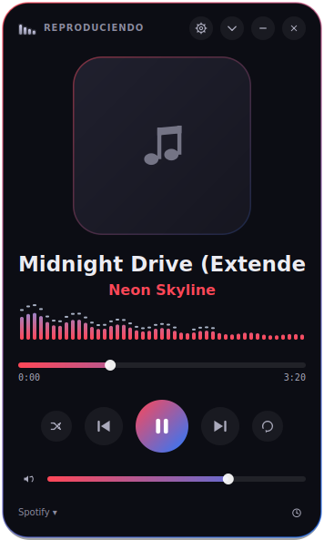
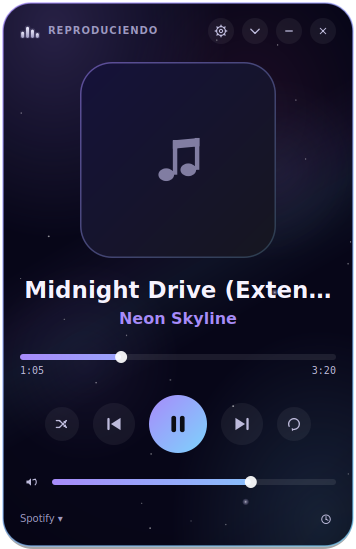
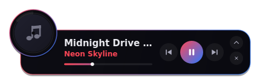
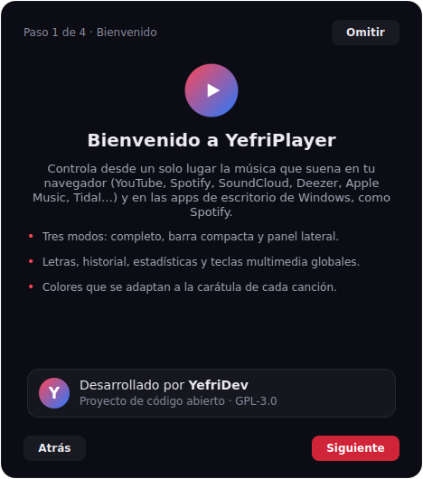
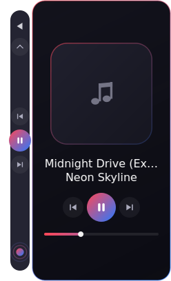
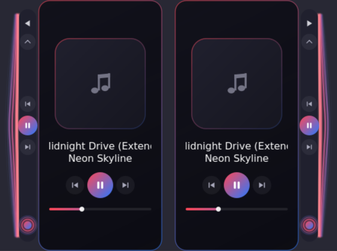

<div align="center">

# YefriPlayer

**Controlador multimedia para Windows**

No reproduce audio: muestra y controla lo que ya suena en tu navegador y en tus apps de escritorio,<br>
con carátula, letras, visualizador de audio y teclas rápidas, desde una sola ventana.

[][descarga]

[](https://github.com/Yeflix/yefriplayer/releases/latest)
[](LICENSE)


&nbsp;&nbsp;

</div>

---

## Índice

- [¿Qué es?](#qué-es)
- [Descargar e instalar](#descargar-e-instalar)
- [Conectar la música del navegador](#conectar-la-música-del-navegador)
- [Qué puede hacer](#qué-puede-hacer)
- [Teclas rápidas](#teclas-rápidas)
- [Preguntas frecuentes y problemas comunes](#preguntas-frecuentes-y-problemas-comunes)
- [Privacidad](#privacidad)
- [Para desarrolladores](#para-desarrolladores)
- [Créditos, aviso legal y licencia](#créditos-aviso-legal-y-licencia)

## ¿Qué es?

YefriPlayer es un **controlador multimedia**. No sustituye a Spotify ni a YouTube: los acompaña. Lee lo que está sonando (título, artista, carátula, posición, volumen) y te deja manejarlo sin cambiar de ventana: reproducir y pausar, saltar canciones, moverte por la barra de progreso, cambiar el volumen, activar aleatorio o repetir.

| Dónde suena tu música | Plataformas compatibles | Qué necesitas |
|---|---|---|
| **En el navegador** | YouTube, YouTube Music, Spotify Web, SoundCloud, Deezer, Apple Music, TIDAL y cualquier sitio compatible con WebNowPlaying | La extensión gratuita **WebNowPlaying** ([ver abajo](#conectar-la-música-del-navegador)) |
| **En el escritorio** | Spotify, Apple Music, TIDAL, Deezer, Reproductor multimedia de Windows y las demás apps que aparecen en los controles multimedia de Windows | Nada: se detectan solas |

## Descargar e instalar

1. Entra en la **[carpeta de descargas de Google Drive][descarga]** y descarga el archivo **`YefriPlayer-<versión>-Setup.exe`** de la versión más alta (clic derecho sobre el archivo → **Descargar**).
   - Como el instalador es grande, Google Drive avisa de que **no puede analizarlo en busca de virus**. Es normal en archivos de ese tamaño: pulsa **Descargar de todas formas**.
2. Ábrelo y sigue el asistente. Se instala **solo para tu usuario y sin pedir permisos de administrador**. Si prefieres instalarlo para todos los usuarios, el asistente te deja elegirlo.
3. Al terminar se abre una **bienvenida de tres pasos** que te guía para conectar la música y comprueba en vivo que todo funciona.

> [!NOTE]
> El instalador todavía no tiene firma digital, así que la primera vez Windows SmartScreen puede mostrar «Windows protegió su PC». Pulsa **Más información → Ejecutar de todas formas**.

**Comprobar que el archivo es el original (opcional).** Cada versión publica la huella **SHA-256** de su instalador en sus [notas de versión](https://github.com/Yeflix/yefriplayer/releases). En PowerShell, desde la carpeta de descargas:

```powershell
Get-FileHash .\YefriPlayer-<versión>-Setup.exe -Algorithm SHA256
```

Si el resultado coincide con el publicado, el archivo no se ha alterado.

**Requisitos:** Windows 10 u 11 de 64 bits. No necesitas instalar Python ni nada más.

YefriPlayer queda registrado como cualquier programa: aparece en **Inicio**, en **Configuración → Aplicaciones → Aplicaciones instaladas** (desde donde se desinstala) y se abre con **Win + R → `YefriPlayer`**. Vive en la bandeja del sistema, junto al reloj.

**Actualizaciones:** una vez al día YefriPlayer comprueba aquí en GitHub si hay una versión nueva. Si la hay, te avisa y te lleva a su página, con el enlace de descarga. Descarga el instalador nuevo y ábrelo: actualiza la versión anterior y **conserva tu configuración, historial y estadísticas**. El aviso se puede desactivar en Configuración.

## Conectar la música del navegador

Las apps de escritorio se detectan solas. Para la música del navegador hace falta la extensión **WebNowPlaying**, que le cuenta a YefriPlayer qué está sonando en cada pestaña:

1. Instálala desde la [Chrome Web Store](https://chromewebstore.google.com/search/WebNowPlaying) (sirve para Chrome, Edge, Brave y Opera) o desde [Firefox Add-ons](https://addons.mozilla.org/firefox/search/?q=WebNowPlaying).
2. Haz clic en su icono para abrir sus opciones y pulsa **«Add custom adapter»** (Adaptador personalizado).
3. Escribe el puerto **`1234`**, déjalo activado y guarda.

Pon algo en YouTube y debería aparecer en YefriPlayer al instante. La bienvenida tiene un botón «Probar con YouTube» y un indicador que te dice si la extensión ya está conectada.

## Qué puede hacer

**Tres formas de verlo** (cámbialas con clic derecho en la ventana):
- **Completa**: carátula grande con colores sacados de la propia imagen, letra, volumen y selector de reproductor.
- **Compacta**: una barra flotante con un vinilo que gira mientras suena.
- **Panel lateral**: una pestaña pegada al borde de la pantalla que se despliega con un clic o al pasar el ratón, en estilo *tarjeta* o *compacto*, con ondas que siguen la música.

Cuando no suena nada o la canción no trae carátula, en su lugar aparece una pequeña **escena 3D animada** (un tocadiscos con ecualizador), que se detiene sola cuando no está a la vista.

**Mientras escuchas:**
- 🎤 **Letras** sincronizadas o en texto plano, desde [lrclib.net](https://lrclib.net).
- 📊 **Visualizador de audio** con el espectro del sonido real. En Windows 11 escucha **solo al reproductor**, sin los avisos del sistema, juegos o llamadas.
- 🔔 **Notificaciones** al cambiar de canción y la canción actual al pasar el ratón por el icono de la bandeja.
- ⌨️ **Teclas rápidas globales**, que funcionan aunque estés en otra ventana.
- 🔊 **Volumen** también para las apps de escritorio (el de su control en el Mezclador de volumen de Windows).
- ▶️ Si no hay nada abierto, al pulsar play se abre Spotify o YouTube.

**Tus datos, en tu equipo:**
- 🕘 **Historial** de las últimas 300 canciones (exportable a CSV), **estadísticas** acumuladas y un **resumen semanal**.
- 🎧 **Scrobbling** a Last.fm o ListenBrainz (opcional). Las pausas no cuentan y, sin conexión, los envíos esperan y salen solos después.
- 💚 **«Me gusta»** en Spotify y YouTube, con tus propias credenciales de desarrollador.
- 🚫 **Anuncios de Spotify** detectados: no ensucian tu historial ni tus estadísticas.

**A tu gusto:**
- Dos aspectos (predeterminado y **Cosmos**), tamaño de letra, alto contraste y «reducir movimiento».
- Configuración con buscador, opción de iniciar con Windows y botones opcionales en la miniatura de la barra de tareas.
- Para usuarios de **Spicetify**: un puente con el tema *Switch* y **Spicetify AutoFix**, que vuelve a aplicar Spicetify solo después de cada actualización de Spotify (se ofrece en el instalador si tienes Spicetify).

<details>
<summary><b>Más capturas</b></summary>
<br>
<br><br>
<br><br>
&nbsp;<br><br>


</details>

## Teclas rápidas

Vienen activadas y funcionan en todo Windows mientras YefriPlayer está abierto:

| Acción | Combinación |
|---|---|
| Reproducir / pausar | <kbd>Ctrl</kbd> + <kbd>Shift</kbd> + <kbd>Espacio</kbd> |
| Siguiente | <kbd>Ctrl</kbd> + <kbd>Shift</kbd> + <kbd>C</kbd> |
| Anterior | <kbd>Ctrl</kbd> + <kbd>Shift</kbd> + <kbd>X</kbd> |

Se cambian o desactivan en **Configuración → Teclas**. Si otro programa ya usa alguna, YefriPlayer te avisa y la marca en rojo como «no funciona»; basta con elegir otra.

## Preguntas frecuentes y problemas comunes

<details>
<summary><b>No aparece lo que suena en el navegador</b></summary>

- Comprueba que la extensión WebNowPlaying está instalada y activada, y que su adaptador personalizado usa el mismo puerto que YefriPlayer (`1234` si no lo cambiaste).
- Recarga la pestaña de la música después de configurar la extensión.
- Si otro programa ocupa el puerto `1234`, YefriPlayer te avisa. Cambia el puerto en Configuración y pon el mismo en la extensión.
</details>

<details>
<summary><b>Una tecla rápida no funciona</b></summary>

Windows solo deja que **un** programa use cada combinación. Si otro ya la tiene (por ejemplo, el atajo de una extensión del navegador marcado como «Global» en `chrome://extensions/shortcuts`), YefriPlayer la marca como «no funciona» en Configuración → Teclas. Elige otra combinación o libera esa en el otro programa.
</details>

<details>
<summary><b>Windows SmartScreen o el antivirus avisan</b></summary>

El instalador no tiene firma digital todavía. Descárgalo solo desde el [enlace oficial de Google Drive][descarga] que aparece en este README y, si quieres, compara su SHA-256 con el publicado (ver [Descargar e instalar](#descargar-e-instalar)). Google Drive también avisa de que no puede analizarlo en busca de virus: le pasa a todos los archivos grandes. Spicetify AutoFix usa un pequeño lanzador que abre PowerShell en segundo plano, algo que a algunos antivirus no les gusta: si lo bloquea, AutoFix usa otro método automáticamente.
</details>

<details>
<summary><b>¿Cómo funciona «Me gusta»?</b></summary>

Necesitas crear tu propia app de desarrollador en [Spotify](https://developer.spotify.com) o [Google Cloud](https://console.cloud.google.com) y pegar sus datos en Configuración → Cuentas. YefriPlayer no incluye credenciales propias y nunca ve tu contraseña: la autorización se hace en tu navegador. En YouTube Music no es posible identificar el vídeo, así que ahí no está disponible.
</details>

<details>
<summary><b>El programa no arranca o se comporta raro</b></summary>

- En **Inicio → YefriPlayer - herramientas → YefriPlayer - autoprueba** se ejecuta una comprobación completa y se abre su informe.
- Si falla al arrancar, se crea `startup-error.log` en `%LOCALAPPDATA%\YefriPlayer`.
- Al [abrir un *issue*](https://github.com/Yeflix/yefriplayer/issues), adjunta ese informe y `error.log` de la misma carpeta.
</details>

<details>
<summary><b>¿Dónde guarda mis datos? ¿Cómo lo desinstalo?</b></summary>

Configuración, historial y estadísticas están en `%LOCALAPPDATA%\YefriPlayer`. Se desinstala desde **Configuración → Aplicaciones**, y el desinstalador te pregunta si quieres borrar también esos datos (por defecto se conservan).
</details>

## Privacidad

- Todo funciona en tu equipo. La conexión con la extensión solo escucha en `127.0.0.1`.
- Solo sale información si activas la función correspondiente: título y artista a lrclib.net (letras), lo que escuchas a Last.fm o ListenBrainz (scrobbling), la autorización de Spotify o Google («Me gusta») y una consulta anónima diaria a GitHub (actualizaciones).
- Tokens y claves se guardan **cifrados** con la protección de datos de Windows (DPAPI).
- El visualizador analiza el sonido solo en memoria: no graba ni envía nada.

## Para desarrolladores

Hecho en **Python + PyQt6**, sobre [pywnp](https://pypi.org/project/pywnp/) y las sesiones multimedia de Windows. Para ejecutarlo desde el código necesitas **Python 3.10, 3.11 o 3.12** (`winsdk` no existe para 3.13+):

```bash
git clone https://github.com/Yeflix/yefriplayer.git
cd yefriplayer
pip install -r requirements.txt
python main.py
```

| Documento | Contenido |
|---|---|
| [`docs/DESARROLLO.md`](docs/DESARROLLO.md) | Cómo funciona por dentro, estructura, pruebas, compilar con Nuitka o PyInstaller, crear el instalador y las reglas del proyecto |
| [`docs/PUBLICAR.md`](docs/PUBLICAR.md) | Cómo sacar una versión: subir el instalador y avisar a las copias instaladas |
| [`CHANGELOG.md`](CHANGELOG.md) | Historial de versiones |

Los errores y las sugerencias van en [Issues](https://github.com/Yeflix/yefriplayer/issues). Si mandas cambios, ejecuta antes las pruebas (`tests/`) y la autoprueba (`python main.py --autotest`).

## Créditos, aviso legal y licencia

- Creado por **[YefriDev](https://github.com/Yeflix)**.
- Se apoya en [pywnp](https://pypi.org/project/pywnp/) y la extensión [WebNowPlaying](https://wnp.keifufu.dev) de keifufu, [PyQt6](https://www.riverbankcomputing.com/software/pyqt/), [aiohttp](https://github.com/aio-libs/aiohttp), [winsdk](https://pypi.org/project/winsdk/), [numpy](https://numpy.org), [PyAudioWPatch](https://pypi.org/project/PyAudioWPatch/) y las letras de [lrclib.net](https://lrclib.net).
- Proyecto independiente, **sin afiliación ni respaldo** de Spotify, Google/YouTube, Last.fm, ListenBrainz ni WebNowPlaying. Los nombres y marcas pertenecen a sus dueños.
- Licencia **[GNU GPL v3.0](LICENSE)**. Copyright © 2026 YefriDev.

<!-- Enlace de descarga: carpeta pública de Google Drive con los instaladores.
     Es el ÚNICO sitio donde hay que cambiarlo (lo usan el botón y las secciones de arriba). -->
[descarga]: https://drive.google.com/file/d/1U866IsHkkrNOiop39ge-V_xpypAiepz3/view?usp=sharing
