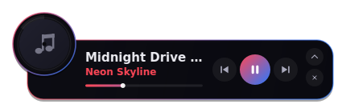
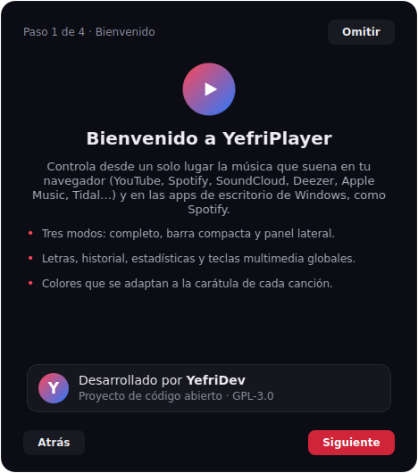
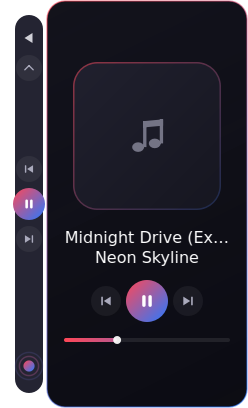
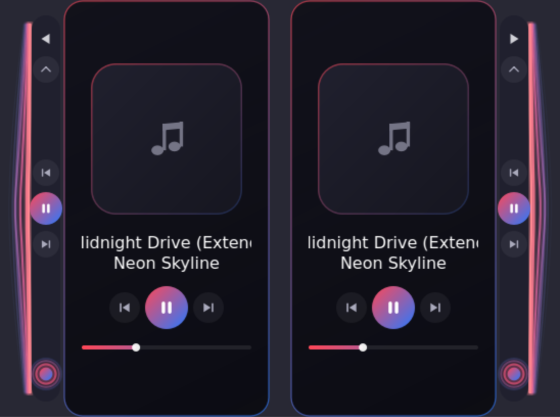

# YefriPlayer · guía técnica

Documento para quien vaya a **compilar, modificar o publicar** YefriPlayer. La presentación para usuarios está en el [README](../README.md) y los cambios de cada versión en el [CHANGELOG](../CHANGELOG.md). Si vas a tocar el código, lee al menos las secciones 3, 4 y 7; para sacar una versión, [PUBLICAR.md](PUBLICAR.md).

## Índice

1. [Qué es](#1-qué-es)
2. [Qué puede hacer](#2-qué-puede-hacer)
3. [Cómo funciona por dentro](#3-cómo-funciona-por-dentro)
4. [Estructura del proyecto](#4-estructura-del-proyecto)
5. [Datos, configuración y privacidad](#5-datos-configuración-y-privacidad)
6. [Instalar, ejecutar, probar, compilar y crear el instalador](#6-instalar-ejecutar-probar-compilar-y-crear-el-instalador)
7. [Puntos importantes al trabajar en la app](#7-puntos-importantes-al-trabajar-en-la-app)
8. [Spicetify AutoFix](#8-spicetify-autofix)
9. [Limitaciones conocidas](#9-limitaciones-conocidas)
10. [Historial de versiones](../CHANGELOG.md)
11. [Créditos, aviso legal y licencia](#11-créditos-aviso-legal-y-licencia)

---

## 1. Qué es

YefriPlayer **no reproduce audio**. Lee el estado de lo que ya suena en otro sitio (título, artista, carátula, posición, volumen, estado) y le manda órdenes (reproducir/pausar, siguiente, anterior, buscar posición, volumen, aleatorio, repetir). Sobre esa información construye una interfaz propia, con tres formas de ventana, letras, historial, estadísticas, "me gusta", scrobbling y un visualizador de audio.

| Fuente | Cómo llega la información |
|---|---|
| Sitios web: YouTube, YouTube Music, Spotify Web, SoundCloud, Deezer, Apple Music, TIDAL… | La extensión **WebNowPlaying** del navegador se conecta por WebSocket al servidor local de `pywnp` (puerto **1234** por defecto) |
| Apps de escritorio de Windows (Spotify, etc.) | Las sesiones multimedia nativas de Windows (SMTC), leídas con `winsdk` a través de `pywnp` |

**Requisitos:** Windows 10/11 y **Python 3.10, 3.11 o 3.12** (`winsdk` no tiene versión para 3.13+; en Linux/macOS sirve cualquier 3.10+, pero sin apps de escritorio, teclas globales ni visualizador). Y la extensión WebNowPlaying en el navegador, con el *adaptador personalizado* apuntando a `localhost:1234`.

## 2. Qué puede hacer

**Ventanas**
- **Completa** (356 px de ancho, 320–460 con la rueda del ratón): carátula con colores de acento extraídos de la imagen, título con marquesina, barra de progreso con *seek*, controles, volumen, selector de reproductor y botón de historial reciente.
- **Compacta**: barra flotante con un vinilo que gira mientras suena.
- **Panel lateral**: pestaña anclada al borde de la pantalla (izquierdo o derecho) que se despliega por clic, por *hover* o ambos; estilo *tarjeta* (con estado «Sonando · Spotify», tiempos y un alto que se adapta a la pantalla) o *compacto*; ondas alrededor de la pestaña mientras suena.
- **Sin carátula, escena 3D**: cuando no hay reproductor o lo que suena no trae carátula, en su lugar se ve la escena 3D de sonido de la bienvenida (también en la etiqueta del vinilo del modo compacto).
- Icono en la **bandeja** con menú, la canción actual al pasar el ratón, notificaciones al cambiar de canción y **teclas globales** configurables. Si no hay ningún reproductor abierto, pulsar **play** abre Spotify o YouTube.
- Opcional: **botón en la barra de tareas** con Anterior / Reproducir / Siguiente en su miniatura (Configuración → «Mostrar en la barra de tareas»; al reiniciar).

**Información y extras**
- **Letras** sincronizadas (LRC) o en texto plano desde [lrclib.net](https://lrclib.net), con limpieza de títulos de YouTube.
- **"Me gusta"** en Spotify y YouTube, con tus propias credenciales de desarrollador.
- **Historial** (300 canciones, exportable a CSV), **estadísticas acumuladas sin límite** y **resumen semanal**, todo local.
- **Scrobbling** a Last.fm o ListenBrainz (opcional): las pausas no cuentan y, sin conexión, los scrobbles esperan en una cola y se envían solos después.
- **Volumen de las apps de escritorio** (Spotify, VLC…): se controla el volumen de la aplicación en Windows (el del Mezclador de volumen).
- **Actualizaciones**: avisa una vez al día si hay una versión nueva en GitHub y, si se instaló con el instalador, se actualiza sola con un clic.
- **Filtro de anuncios de Spotify**: no ensucian el historial ni las estadísticas; se registran aparte en un CSV.
- **Visualizador de audio** opcional: espectro del sonido real, analizado solo en memoria. En Windows 11 (y en algunos Windows 10) escucha **solo al reproductor** (Spotify o el navegador), no los avisos, juegos o llamadas; si no se puede, todo el equipo.
- **Dos aspectos** (predeterminado y *Cosmos*), accesibilidad (tamaño de letra, alto contraste, reducir movimiento) y escala automática según la resolución.
- **Configuración con búsqueda y secciones**, e **inicio con Windows** (por-usuario, sin permisos de administrador).
- Puente con el tema **Switch** de Spicetify (cambiar de modo del tema desde el reproductor) y **Spicetify AutoFix** (reaplica Spicetify tras una actualización de Spotify).

<details>
<summary>Más capturas</summary>

<br>
<br>
 <br>


</details>

## 3. Cómo funciona por dentro

```
   Navegador                         Windows
 ┌───────────────┐              ┌──────────────────┐
 │ WebNowPlaying │              │ SMTC (Spotify,   │
 │  (extensión)  │              │ apps de escrit.) │
 └───────┬───────┘              └────────┬─────────┘
         │ WebSocket 127.0.0.1:1234      │ winsdk
         └──────────────┬────────────────┘
                        ▼
              ┌───────────────────┐
              │ pywnp (+ parche)  │  servidor aiohttp en hilos propios
              └─────────┬─────────┘
                        │ WNPRedux.media_info  (se LEE, no se empuja)
                        ▼
              ┌───────────────────┐   QTimer 150 ms (700 ms con todo oculto)
              │   WNPBackend      │──► PlayerState (dataclass inmutable)
              └─────────┬─────────┘    señales: stateChanged, connectionChanged, serverError…
                        ▼
              ┌───────────────────┐
              │  AppController    │  coordina ventanas, bandeja y servicios
              └───┬───┬───┬───┬───┘
        ┌─────────┘   │   │   └──────────┐
        ▼             ▼   ▼              ▼
   MainWindow    MiniWindow DockWindow   Servicios: historial · estadísticas · anuncios ·
   (completa)    (compacta) (panel)      scrobbling · letras · carátulas · "me gusta" ·
                                         teclas globales · tema de Spotify · bandeja
```

**Ideas de diseño que se repiten por todo el código**

- **El backend no empuja datos**: lee `pywnp` cada 150 ms y emite un `PlayerState` solo si cambió respecto al anterior.
- **Una canción se registra tras 500 ms estable** (`TRACK_SETTLE_MS`): la extensión manda título, artista y duración en mensajes separados, y sin esa espera se guardaban entradas mezcladas en el historial y en Last.fm.
- **Todo lo lento va a hilos de Python** (`workers.py`): carátulas, letras, scrobbling, "me gusta", OAuth. La interfaz solo recibe resultados por señales. No se usa `QThreadPool` (Nuitka avisa de que los hilos propios de Qt no funcionan bien con PyQt6).
- **Red solo con la biblioteca estándar** (`urllib`), sin `requests`.
- **Los estilos se construyen una vez** al crear cada widget: cambiar aspecto, tamaño de letra o contraste pide reiniciar.
- **Las animaciones van por reloj real** (`time.monotonic`), se detienen cuando el widget no es visible o con "reducir movimiento", y lo que no cambia entre fotogramas se cachea en un `QPixmap`.
- **Los controles responden al instante**: play/pausa, aleatorio, repetir, volumen y posición muestran lo pedido hasta que el reproductor lo confirma (y revierten si lo ignora).

**Arranque (`main.py`)** — el orden importa:

1. Lee argumentos (`--port`, `--autotest`, `--log`, `--quit`). Con `--autotest` ejecuta la autoprueba y sale; con `--quit` pide a la copia abierta que se cierre y sale.
2. Carga la configuración y fija la **escala** (`screen_scale.configure`) **antes** de crear `QApplication` (`QT_SCALE_FACTOR` solo se lee al iniciar Qt).
3. Aplica el **aspecto** (`theme.set_player_theme`) **antes** de importar `app_controller` (varios módulos leen `Palette` al importarse).
4. Crea `QApplication` con `setQuitOnLastWindowClosed(False)` (la app vive en la bandeja), paleta oscura y QSS global.
5. Instala el manejador global de errores y comprueba dependencias.
6. `SingleInstanceGuard`: si ya hay otra instancia, le pide que se muestre y esta termina. Si es la primera, crea además el mutex `YefriPlayerAppMutex` (lo usa el instalador para saber que está abierta) y fija el AppUserModelID `YefriDev.YefriPlayer` (agrupa la barra de tareas con el acceso directo).
7. Crea `AppController`, `controller.start()` y `app.exec()`.

Cualquier excepción durante el arranque se guarda en `startup-error.log` y se muestra en un aviso de Windows (el `.exe` no tiene consola).

## 4. Estructura del proyecto

```
main.py                 punto de entrada
requirements.txt        dependencias (versiones verificadas)
main.spec               receta de PyInstaller
Construir-Instalador.bat  doble clic: compila y crea YefriPlayer-<versión>-Setup.exe (sección 6)
installer/              YefriPlayer.iss (Inno Setup): el instalador que registra la app en Windows
assets/                 yefriplayer.ico (ícono del .exe; se regenera con tools/generar_icono.py)
docs/                   DESARROLLO.md (esta guía), PUBLICAR.md (sacar una versión) e img/ (capturas)
README.md, CHANGELOG.md  presentación para GitHub e historial de versiones
tools/                  compilador Nuitka, diagnósticos, userscript de YouTube
SpicetifyAutoFix/       tarea programada que reaplica Spicetify (sección 8)
tests/                  51 scripts de prueba + un arnés (harness_free.py) + pruebas del userscript (tests/userscript)
```

### Núcleo
| Archivo | Responsabilidad |
|---|---|
| `main.py` | Punto de entrada, `--autotest`, `--log`, aviso de fallos de arranque |
| `app_controller.py` | **Centro de la app**: crea y conecta backend, ventanas, bandeja y servicios; guarda la configuración cada 20 s y al salir |
| `backend.py` | `WNPBackend` y `PlayerState`: sondeo de pywnp, control, cambio de puerto |
| `pywnp_patch.py` | Corrige en memoria 12 errores de `pywnp` 2.0.2 (no modifica la librería instalada) |
| `config.py` | `AppConfig` (dataclass, 55 campos) guardada como JSON de forma atómica y validada al cargar; no reescribe si nada cambió y no importa Qt |
| `secret_store.py` | Cifra con DPAPI (Windows) los tokens y claves de `config.json` |
| `startup_checks.py`, `single_instance.py` | Comprobación de dependencias; instancia única por socket local (órdenes `show` y `quit`) y mutex para el instalador |
| `error_handling.py`, `diag.py`, `debug_log.py`, `selftest.py` | Manejo de errores, avisos silenciosos, modo depuración y autoprueba (ver sección 7) |
| `version.py` | Nombre, versión, autor, `User-Agent` y `executable_path()` (**única fuente**) |
| `workers.py` | Hilos de fondo con la biblioteca estándar |

### Interfaz
| Archivo | Responsabilidad |
|---|---|
| `main_window.py`, `mini_window.py`, `dock_window.py` | Las tres ventanas (completa, compacta, panel lateral) |
| `widgets.py` | Componentes: `IconButton`, `SeekBar`, `VolumeBar`, `ElidedLabel`, `MarqueeLabel`, `CoverArt`, `VinylCover`, `LyricsPanel`, `PlayingIndicator`… |
| `dialogs.py` | Configuración, puerto, Acerca de, errores, teclas, historial, estadísticas |
| `splash.py` | Pantalla de carga: la escena 3D mientras se importa la interfaz (en un hilo) y su transformación en la ventana del modo actual |
| `welcome_fx.py` | Efectos de la bienvenida: escena 3D de sonido (`SoundScene` = el dibujo, con cámara en perspectiva propia; `SoundStage` = widget de la bienvenida y la carga; `IdleScene` = la escena dentro de las carátulas sin imagen), puntos de progreso, cambio de paso como tarjeta que gira y confeti (QPainter, sin OpenGL) |
| `likes_dialog.py`, `onboarding.py`, `weekly_recap.py` | Conectar cuentas, asistente de bienvenida, aviso semanal |
| `theme.py`, `accent.py`, `cosmos_sky.py` | Paleta, aspectos, accesibilidad y QSS global; colores de acento desde la carátula; cielo animado de *Cosmos* |
| `icons.py`, `app_icon.py` | Iconos dibujados por código (`QPainterPath`, lienzo 24×24) |
| `screen_scale.py` | Escala de la interfaz según la altura útil de la pantalla |
| `audio_levels.py` | Visualizador: captura (por aplicación o de todo el equipo) y análisis de espectro |
| `process_loopback.py` | Captura del audio de un solo proceso (Application Loopback, COM con `ctypes`) |
| `taskbar_buttons.py` | Botones en la miniatura de la barra de tareas (`ITaskbarList3`) |
| `wincom.py` | Ayudas mínimas para COM de Windows con `ctypes` (sin `comtypes`) |
| `autostart.py`, `hotkeys.py`, `player_launcher.py` | Inicio con Windows (`HKCU\…\Run`), teclas globales (`RegisterHotKey`), abrir Spotify/YouTube y otros |

### Funciones
| Archivo | Responsabilidad |
|---|---|
| `lyrics.py` | Búsqueda en lrclib: limpieza de títulos, ranking de resultados, reintento, recarga |
| `likes.py`, `oauth_pkce.py` | Clientes de Spotify/YouTube y `LikeManager`; OAuth 2.0 con PKCE |
| `history.py`, `stats.py` | Historial local (300 entradas, exportar a CSV) y estadísticas (funciones puras) |
| `stats_store.py` | Estadísticas acumuladas sin el límite de 300 |
| `app_volume.py` | Volumen por aplicación de Windows para apps de escritorio (Core Audio) |
| `updater.py` | Buscar versiones nuevas en GitHub, descargar y abrir el instalador |
| `ad_filter.py`, `ad_log.py` | Detección de anuncios de Spotify y su registro aparte (CSV) |
| `scrobbling.py` | Last.fm y ListenBrainz; tiempo escuchado sin pausas y cola sin conexión |
| `cover_loader.py`, `links.py`, `youtube_api.py` | Descarga de carátulas (caché de 24); "ir a la canción" |
| `spotify_theme.py` | Puente WebSocket (127.0.0.1:8977) con el tema *Switch* de Spicetify |

### Herramientas (`tools/`)
| Herramienta | Qué hace |
|---|---|
| `compilar_nuitka.py` | Compila con Nuitka y comprueba el resultado (sección 6) |
| `construir_instalador.py` | Compila y crea el instalador con Inno Setup (sección 6) |
| `diagnostico_sesiones.py` | Si no se detecta Spotify de escritorio: revisa las tres capas (Spotify → sesión de Windows → pywnp y parche) y emite un veredicto |
| `diagnostico_anuncios.py` | Registra lo que WebNowPlaying reporta durante un anuncio (cerrar YefriPlayer antes: comparten puerto) |
| `youtube_saltar_anuncios.user.js` | Userscript (Tampermonkey/Violentmonkey) que pulsa «Saltar anuncio» en YouTube; sin peticiones de red |
| `generar_icono.py` | Regenera `assets/yefriplayer.ico` |

## 5. Datos, configuración y privacidad

**Carpeta de datos** (`YefriPlayer`): Windows `%LOCALAPPDATA%\YefriPlayer` · macOS `~/Library/Application Support/YefriPlayer` · Linux `$XDG_CONFIG_HOME/YefriPlayer` (o `~/.config/YefriPlayer`). Nada de esto forma parte del repositorio.

| Archivo | Contenido |
|---|---|
| `config.json` | Configuración. Escritura atómica; los secretos van cifrados con DPAPI (`dpapi:<base64>`) |
| `history.json` | Historial (máx. 300). Copias `.bak` / `.corrupt` si procede |
| `estadisticas.json` | Estadísticas acumuladas (veces y tiempo por canción, por artista, totales). Se borra con «Borrar historial» |
| `scrobbles_pendientes.json` | Scrobbles que no se pudieron enviar (sin conexión); desaparece cuando se envían. Máx. 2000; Last.fm no acepta los de más de 14 días |
| `anuncios.csv` | Registro de anuncios de Spotify (los textos que empiezan por `=`, `+`, `-`, `@` se escapan) |
| `ad_rules.json` | Reglas extra de anuncios, opcional: `{"artistas": [...], "titulos": [...]}` |
| `error.log`, `crash.log` | Errores no controlados (rota a 512 KB) y fallos nativos (`faulthandler`) |
| `startup-error.log`, `debug.log`, `autotest.txt` | Fallo de arranque; registro completo del modo depuración (rota a 2 MB × 3); informe de la autoprueba |

**Campos de `config.json`** (por grupos): conexión (`port`); ventanas (`last_mode`, `always_on_top`, `main_*`, `mini_*`, `dock_edge`, `dock_hide_mode`, `dock_style`, `window_opacity`, `lyrics_panel_*`); arranque (`start_with_windows`, `start_minimized`, `onboarding_completed`); comportamiento (`notifications_enabled`, `empty_play_action`, `hotkeys_*`, `audio_visualizer`, `bar_waves_enabled`); aspecto y accesibilidad (`player_theme`, `font_scale`, `ui_scale`, `high_contrast`); cuentas (`spotify_*`, `google_*`, `likes_enabled`, `youtube_api_key`); scrobbling (`scrobble_service`, `lastfm_*`, `listenbrainz_token`); tema de Spotify (`spotify_theme_*`); actualizaciones (`check_updates`, `last_update_check`, `skipped_update_version`); barra de tareas (`taskbar_button`); visualizador por aplicación (`visualizer_per_app`); y estado (`history_scroll_pos`, `stats_scroll_pos`, `last_weekly_recap_shown`). Al cargar, `AppConfig._sanitize` descarta valores de tipo incorrecto u opciones desconocidas (vuelven a su valor por defecto) y recorta rangos (puerto 1–65535, `font_scale` 0,8–1,6, `window_opacity` 0,5–1,0…).

**Secretos** (`secret_store.SECRET_FIELDS`): `spotify_refresh_token`, `google_client_secret`, `google_refresh_token`, `lastfm_api_secret`, `lastfm_session_key`, `listenbrainz_token`, `youtube_api_key`. DPAPI solo los descifra la misma cuenta de Windows en el mismo equipo; no es una caja fuerte (un programa con tu usuario puede pedírselos a Windows). Copiar `config.json` a otro equipo obliga a reconectar las cuentas. Un valor pegado a mano en texto plano se acepta y se cifra en el siguiente guardado. En macOS/Linux no hay cifrado (el archivo queda con permisos 600). La contraseña de Last.fm nunca se guarda.

**Privacidad**
- El servidor de la extensión (1234) y el puente del tema (8977) escuchan **solo en `127.0.0.1`**. El puente no comprueba el origen de la conexión (impacto bajo).
- Lo único que sale del equipo, y solo si activas cada función: artista/título/álbum/duración a lrclib.net (letras); lo que escuchas a Last.fm/ListenBrainz (scrobbling); la autorización a Spotify/Google (me gusta, en el navegador: la app nunca ve tu contraseña); la clave de YouTube Data API (vídeo exacto); las URL de carátulas que entregue el reproductor; y, con «Buscar actualizaciones», una consulta anónima a la API de GitHub una vez al día (solo el `.exe`; desde el código, solo a mano).
- Las credenciales de "me gusta" son **de tu propia app** de desarrollador (developer.spotify.com / Google Cloud); el proyecto no incluye ninguna.
- Spotify en modo desarrollo: el dueño de la app necesita **Premium**, máximo 5 usuarios autorizados y una sola app por desarrollador; el *Redirect URI* es `http://127.0.0.1:8898/callback`. En Google, pantalla de consentimiento **publicada** (en modo prueba el permiso caduca a los 7 días). Confirma estos límites en la documentación de cada servicio: cambian.
- El visualizador analiza el sonido solo en memoria: nada se graba ni se envía.

## 6. Instalar, ejecutar, probar, compilar y crear el instalador

**Para usarlo** basta con el instalador `YefriPlayer-<versión>-Setup.exe`: doble clic y siguiente. Por defecto se instala **solo para tu usuario, sin pedir administrador** (en `%LOCALAPPDATA%\Programs\YefriPlayer`); el asistente permite elegir «para todos los usuarios» (Archivos de programa). Queda registrado como cualquier programa:

- En **Configuración → Aplicaciones → Aplicaciones instaladas** (y en «Programas y características»), con icono, versión, editor, enlaces y su desinstalador.
- Acceso en **Inicio** (y en el escritorio si se marca), más una carpeta «YefriPlayer - herramientas» con el modo depuración, el estado y la reparación de Spicetify AutoFix y el desinstalador.
- **Win+R → `YefriPlayer`** lo abre («App Paths»).
- Si Spicetify está instalado, una casilla instala **Spicetify AutoFix** (sección 8) con tu usuario, aunque el programa se instale para todos.
- Si YefriPlayer está abierto al actualizar o desinstalar, se le pide que se cierre de forma ordenada (guarda la configuración); una copia antigua que no entienda la orden se cierra a la fuerza tras preguntarte.
- Al desinstalar se quitan la entrada de «Iniciar con Windows» y la tarea de AutoFix (si la instaló él), y **pregunta** si borrar tus datos (`%LOCALAPPDATA%\YefriPlayer`; por defecto «No»).
- Instalación desatendida: `YefriPlayer-<versión>-Setup.exe /VERYSILENT /SUPPRESSMSGBOXES /CURRENTUSER` (añade `/TASKS="autofix"` para AutoFix y `/ALLUSERS` para todos los usuarios).

**Desde el código fuente:**

```bash
git clone https://github.com/Yeflix/yefriplayer.git
cd yefriplayer
pip install -r requirements.txt
python main.py                 # usa el puerto de la última sesión (por defecto 1234)
python main.py --port 5678     # fija otro puerto
```

La primera vez (y tras instalar con el instalador) aparece una bienvenida corta de 3 pasos con una escena 3D de sonido (vinilo girando, ecualizador en anillo, ondas y notas): qué es, cómo conectar la música (la extensión WebNowPlaying en tres pasos, con un indicador que comprueba EN VIVO si está conectada y si ya llega lo que suena, y un botón «Probar con YouTube») y las teclas rápidas con «Iniciar con Windows». Lo demás queda con los valores recomendados; «Omitir» acepta lo mismo. Para verlo otra vez: `python main.py --bienvenida` o clic derecho en la ventana → «Ver bienvenida de nuevo...».

**Valores predeterminados** (instalación nueva o `config.json` nuevo): iniciar con Windows **sí**; siempre visible **no**; iniciar minimizado **no** (y aunque se active, solo aplica cuando arranca con Windows: abrirlo a mano siempre muestra la ventana); notificar la canción **sí**; buscar actualizaciones **sí**; barra de tareas **no**; visualizador de audio **sí**, con «solo el audio del reproductor» **sí**. **Teclas rápidas globales activas:** Reproducir/pausar `Ctrl+Shift+Espacio`, Siguiente `Ctrl+Shift+C`, Anterior `Ctrl+Shift+X` (mientras YefriPlayer está abierto esas combinaciones son suyas en todo el sistema: `Ctrl+Shift+C` es «inspeccionar elemento» en los navegadores; se cambian en Configuración → Teclas).

**Pruebas.** Son scripts independientes (no usan `pytest`; cada uno termina con `sys.exit`) y se ejecutan sin pantalla:

```bash
QT_QPA_PLATFORM=offscreen python tests/test_ads.py
# todos:
for t in tests/test_*.py; do QT_QPA_PLATFORM=offscreen python $t || echo "FALLA $t"; done
```

(En PowerShell: `$env:QT_QPA_PLATFORM="offscreen"` antes de ejecutarlas.) El userscript tiene sus propias pruebas con jsdom: `cd tests/userscript && npm install && node test_userscript.js`.

**Compilar con Nuitka (recomendado)**

```bash
pip install nuitka ordered-set zstandard
python tools/compilar_nuitka.py            # carpeta dist-nuitka/YefriPlayer/
python tools/compilar_nuitka.py --dry-run  # solo muestra el comando
```

Necesita un compilador de C: en Windows, *Build Tools for Visual Studio* (carga «Desarrollo para el escritorio con C++») o `--mingw --asumir-si`. La primera compilación tarda; las siguientes usan caché. Opciones: `--onefile`, `--console`, `--depurar`, `--lto`, `--msvc`, `--winsdk-completo`, `--limpiar`, `--extra=OPCION`, `--sin-autotest`. **Al terminar ejecuta solo `YefriPlayer.exe --autotest`** y muestra lo que falte (Qt, aiohttp, pywnp, winsdk con una llamada real a Windows, numpy, PyAudioWPatch, DPAPI, carpeta de datos). Para repartirlo, comprime la carpeta completa en un `.zip`.

**Compilar con PyInstaller**: `pip install pyinstaller && pyinstaller main.spec` → carpeta `dist/YefriPlayer/` (modo *onedir*: arranca al instante y da menos falsos positivos de antivirus; sin UPX).

**Crear el instalador** (Windows):

```bash
winget install --id JRSoftware.InnoSetup -e    # una sola vez (Inno Setup 6.3 o posterior)
python tools/construir_instalador.py           # compila con Nuitka + autoprueba + instalador
python tools/construir_instalador.py --pyinstaller   # o con PyInstaller
python tools/construir_instalador.py --sin-compilar  # reutiliza lo ya compilado
python tools/construir_instalador.py --nuitka=--mingw --nuitka=--asumir-si   # opciones para Nuitka
```

O doble clic en `Construir-Instalador.bat` (usa `.venv` si existe, si no `py -3.12`). Resultado: `dist-installer/YefriPlayer-<versión>-Setup.exe` y su SHA-256. La versión sale de `version.py`; si la compilación o su `--autotest` fallan, no se crea el instalador. El script de Inno Setup es `installer/YefriPlayer.iss`: **no cambies su `AppId`** (es lo que permite actualizar y desinstalar las versiones anteriores). Sin firma digital, Windows SmartScreen avisará la primera vez («Más información → Ejecutar de todas formas»).

**Publicar una versión:** paso a paso en [PUBLICAR.md](PUBLICAR.md). El instalador se sube a una carpeta pública de Google Drive (el enlace del README) y en GitHub se crea una *release* `v<versión>` (igual que `version.py`, publicada, ni borrador ni *pre-release*) cuyas notas llevan el enlace y el SHA-256: es lo que consulta el programa para avisar. Si además se adjunta `YefriPlayer-<versión>-Setup.exe` con ese nombre exacto a la *release* (cabe: hasta 2 GiB por archivo), las copias instaladas se actualizan con un clic.

**Ejecutar la autoprueba desde PowerShell.** PowerShell no busca programas en la carpeta actual ni en la de instalación: hay que dar la ruta (y `&` delante si va entre comillas). Con el programa instalado:

```powershell
& "$env:LOCALAPPDATA\Programs\YefriPlayer\YefriPlayer.exe" --autotest --mostrar
# instalado «para todos»:  & "$env:ProgramFiles\YefriPlayer\YefriPlayer.exe" --autotest --mostrar
# recién compilado:        .\dist-nuitka\YefriPlayer\YefriPlayer.exe --autotest --mostrar
# desde el código:         python main.py --autotest     (aquí sí se ve en la terminal)
Get-Content "$env:LOCALAPPDATA\YefriPlayer\autotest.txt"   # el informe, si prefieres verlo en la terminal
```

**Si el `.exe` falla o se porta raro**

| Herramienta | Para qué |
|---|---|
| `YefriPlayer.exe --autotest [archivo]` | Comprueba que el ejecutable trae todo; escribe `autotest.txt` (en la carpeta de datos). Añade `--mostrar` para que abra el informe al terminar: el `.exe` no tiene consola y en la terminal no se ve nada. También: Inicio → «YefriPlayer - herramientas» → «YefriPlayer - autoprueba» |
| `startup-error.log` | Se crea solo si algo falla al arrancar (además sale un aviso de Windows) |
| `YefriPlayer.exe --quit` | Cierra de forma ordenada la copia abierta (la usa el instalador) |
| `YefriPlayer.exe --log [archivo]` (o `YEFRIPLAYER_DEBUG=1`, o un archivo `depurar.flag` junto al `.exe`) | Abre una terminal y guarda TODO en `debug.log`: lo que imprime el programa, avisos de Qt, `logging`, excepciones (también de hilos) y lo que va a `error.log` |
| `python tools/compilar_nuitka.py --depurar` | Compila con terminal visible y deja `depurar.flag` |

**Actualizar desde una versión anterior:** con el instalador, simplemente ejecuta el nuevo (cierra la copia abierta, conserva carpeta, opciones y datos). Desde un `.zip` o el código: cierra YefriPlayer (bandeja → Salir), usa la carpeta nueva (o `git pull` + `pip install -r requirements.txt --upgrade`) y ábrelo; tu configuración vive fuera de la carpeta del programa. Quien venga de *WNP Player* (1.0/1.1): al primer arranque se **copian** los datos de `%LOCALAPPDATA%\WNPPlayer` a `YefriPlayer` y se elimina la entrada vieja de «Iniciar con Windows».

## 7. Puntos importantes al trabajar en la app

Son las reglas que más errores evitan. Casi todas nacieron de un fallo real.

### Qué no se puede probar aquí
- Todo lo que depende de **Windows real** (SMTC, `RegisterHotKey`, DPAPI, Programador de tareas, el `.exe`) y de **servicios externos** (Spotify, YouTube, Last.fm) se probó solo con servidores y funciones simulados. Tras tocar eso, comprueba en Windows: `--autotest`, abrir el reproductor con música sonando, y mirar `error.log`.
- Las pruebas corren en Qt *offscreen*, sin Segoe UI: usan una fuente más ancha. Lo que cabe allí, cabe en Windows; al revés puede no ocurrir. `test_settings_dialog.py` termina a veces con un cierre brusco de Qt *offscreen* (≈ 2 de 30 ejecuciones, también con el código original); sus comprobaciones dan siempre ok.

### Estructura y datos
- **`PlayerState` es inmutable y el backend no empuja.** Para exponer un dato nuevo: campo en `PlayerState`, lectura en `backend.py`, uso en la ventana. No guardes estado del reproductor en las ventanas.
- **Hilos:** nada lento en el hilo de la interfaz. Usa `workers.py` y devuelve resultados por señal. No uses `QThreadPool`.
- **Orden de arranque** (sección 3): escala antes de `QApplication`, aspecto antes de importar `app_controller`. Reordenarlo rompe en silencio.
- **Añadir un ajuste:** campo en `AppConfig` → validación en `_sanitize` (tipo y rango) → control en `SettingsDialog` (si abre sección, registra su ancla en `_nav_anchors`) → guardado en `AppController` → una prueba. Si es un secreto, añádelo a `secret_store.SECRET_FIELDS`.
- **`version.py` es la única fuente** de nombre, versión y autor (la leen el `User-Agent`, el diálogo Acerca de, el `.exe`, el script de Nuitka y el instalador). Sube la versión ahí.
- **Instalador y código hablan de lo mismo:** el mutex (`single_instance.APP_MUTEX_NAME`), el canal de instancia única (`_SERVER_NAME`), el AppUserModelID (`main.APP_USER_MODEL_ID`) y la entrada de inicio (`autostart.VALUE_NAME`) están repetidos en `installer/YefriPlayer.iss`. `tests/test_instalador.py` falla si dejan de coincidir; si renombras uno, cambia el otro.
- **`config.py` no debe importar PyQt6** (`DEFAULT_PORT` vive ahí y `backend.py` lo reexporta): así la configuración se lee antes de Qt y se prueba sin él.
- **Compatibilidad con «WNP Player»:** las constantes de migración en `config.py` y `autostart.py` (carpeta `WNPPlayer`, entrada del registro) son **intencionales**; no las borres.
- **`pywnp` está fijado** (`>=2.0.2,<2.1`) porque `pywnp_patch.py` está escrito contra esa versión. Si `apply()` falla, avisa por stderr y la app sigue; si subes pywnp, revisa los 12 parches.

### Interfaz
- **Los estilos se construyen una vez** (QSS y fuentes al crear el widget): un cambio de aspecto, escala o contraste pide reiniciar; no intentes aplicarlo en caliente.
- **Todo estado necesita estilo:** `:hover`, `:focus`, `:checked` y **`:disabled`** (un botón deshabilitado sin regla se ve activo). `:disabled` va **después** de `:hover` en el QSS.
- **Contraste:** el texto debe llegar a 4,5:1 contra su fondo; usa `theme.ensure_contrast` con colores de acento dinámicos (la carátula puede dar un azul oscuro de 1,8:1). Los enlaces usan el acento principal aclarado.
- **Nombres accesibles:** un control sin texto (botón de icono, deslizador) necesita tooltip o `accessibleName`; `IconButton` copia el tooltip y `widgets.sync_accessible_names` cubre el resto.
- **Textos largos:** `ElidedLabel` recorta con «…» (o elige entre variantes con `set_variants`), `MarqueeLabel` se desplaza (o se reparte en líneas con movimiento reducido). No pongas `setFixedWidth` a un texto que puede cambiar.
- **Escalas:** prueba a 0,88, 1,0 y 1,3, ancho mínimo (320) y movimiento reducido.

### Animaciones y rendimiento
- **Un temporizador de animación debe detenerse al ocultarse Y no arrancar mientras el widget esté oculto** (`isVisible()`). Si no, sigue despertando al procesador con el programa en la bandeja (pasó con `PlayingIndicator`).
- **Lo que no cambia entre fotogramas se dibuja una vez** en un `QPixmap` (con `devicePixelRatio`) y el fotograma solo lo copia o lo gira: marquesina, vinilo, carátula, ondas del dock. La **clave de la caché** debe incluir todo lo que afecta al dibujo (tamaño, colores, imagen, densidad) y se descarta sola al cambiar; durante un fundido se dibuja sin caché. Hay pruebas que comparan «cacheado = dibujado directo».
- **Dos temporizadores sobre la misma zona** provocan dos repintados: alinéalos (mismo intervalo, arranque a la vez) para que Qt los junte. Un hijo no opaco hace que el padre se repinte cada vez que el hijo se actualiza.
- **Medir antes de optimizar:** para saber qué temporizador cuesta más, páralos de uno en uno y mira cuánto baja la CPU (ablación), o mide el tiempo de cada `paintEvent`. La intuición suele equivocarse.
- Sondeo del backend: 150 ms con alguna ventana visible, 700 ms con todo oculto (`set_poll_interval`).

### PyQt6 + Nuitka (el `.exe`)
- **Imports estáticos:** Nuitka solo incluye lo que ve importado. `audio_levels` importa `numpy` y `pyaudiowpatch` de forma estática a propósito; con `importlib.import_module` el `.exe` diría «falta numpy». No fuerces `--include-package=numpy` (arrastra sus pruebas y pytest) ni excluyas `unittest`/`test`/`pydoc`.
- **`sys.executable` no es fiable** en el binario compilado (apunta a un archivo inexistente, y con `--onefile` a una copia temporal): usa `version.executable_path()` (`sys.argv[0]`). Nuitka no marca `sys.frozen`: usa `version.is_frozen()`.
- **Señales hacia objetos de vida larga:** PyQt desconecta solo los métodos de un `QObject` destruido, pero con Nuitka no reconoce al receptor y la señal llega a un widget borrado (`wrapped C/C++ object … has been deleted`). Si un diálogo se conecta a algo que vive más que él (como el puente del tema), desconéctalo explícitamente al cerrarse (`SettingsDialog._disconnect_theme_bridge`) y protege los manejadores con `sip.isdeleted`.
- **`winsdk`** es un paquete sin `__init__` con un único `_winrt.pyd`; la lista mínima de módulos del script basta (la autoprueba hace una llamada real). Si falta alguno: `--winsdk-completo`.
- El `.exe` va **sin consola**: `sys.stdout`/`sys.stderr` son `None`. Nunca escribas en ellos sin comprobar (el manejador de errores falló dentro de sí mismo por eso).

### Errores y registro
- **No te tragues errores con `try/except: pass`.** Usa `diag.soft("contexto")` (anota UNA línea en `error.log` y sigue) o `contextlib.suppress(...)` si el fallo es esperado. Cada contexto se anota una sola vez por sesión.
- `error_handling.py` muestra un diálogo amable (uno a la vez; el mismo error no se repite en 60 s) y escribe siempre en `error.log`. `debug_log.py` lo recoge todo cuando se activa el modo depuración.
- Los secretos nunca deben llegar a un registro ni a un mensaje de error.

### Pruebas
- Un script por tema, con la función `check(nombre, condición)` y `sys.exit(1)` si algo falla. Usa una carpeta de datos temporal (`XDG_CONFIG_HOME` y `LOCALAPPDATA`) para no tocar la tuya.
- **No simules dibujo con «parece bien»:** compara imágenes (diferencia media) entre lo cacheado y lo directo, o mide temporizadores activos con la ventana oculta.
- Antes de entregar: todas las pruebas, `ruff check --select F,E9,B,PLE,PLW,S110,S112,SIM105` sin avisos, `python main.py --autotest`, y compilar y ejecutar `--autotest` del `.exe`.

### Estilo del código
- Comentarios y textos de interfaz en **español**; los comentarios explican el **porqué** (qué falló antes), no el qué.
- Los `global` que quedan son estado de módulo a propósito (lo leen otros módulos o las pruebas) y llevan `# noqa: PLW0603` con la razón.
- Archivos grandes (`widgets.py`, `main_window.py`, `dialogs.py`, `dock_window.py`): se decidió no dividirlos por ahora; si lo haces, mueve primero las pruebas que importan sus nombres.

## 8. Spicetify AutoFix

Carpeta `SpicetifyAutoFix/`. Es **independiente del reproductor** y solo para Windows. Resuelve un problema concreto: cada vez que Spotify se actualiza, **Spicetify deja de estar aplicado** y hay que ejecutar `spicetify backup apply` a mano. Esta tarea programada lo hace sola, **sin ventanas**.

**Instalar:** marca la casilla en el instalador de YefriPlayer, o doble clic en `Instalar.bat` con tu usuario normal (**no** «como administrador»; si lo haces, avisa); debe terminar con `Listo: la tarea funciona.` Si ya lo tenías, vuelve a ejecutarlo para actualizarlo. Utilidades: `Estado.bat` (método de lanzamiento), `Comprobar-ahora.bat`, `Desinstalar.bat`. Datos en `%LOCALAPPDATA%\SpicetifyAutoFix` (`estado.json`, `autofix.log`, `ultima-comprobacion.txt`).

**Qué detecta** (`Spicetify-AutoFix.ps1`): *caso A*, la versión de `Spotify.exe` difiere de la guardada en `[Backup] version` de `config-xpui.ini` (Spotify se actualizó); *caso B*, las versiones coinciden pero los `.js` de `xpui` ya no contienen «Spicetify» (perdió el parche; se guarda una huella de tamaño y fecha para no releer decenas de MB). **Antes de actuar** espera a que `Spotify.exe` lleve 90 s estable y no haya un instalador en marcha, respeta un enfriamiento de 30 min entre intentos (24 h para el caso B) y usa un mutex. **Acción:** `spicetify backup apply`; si falla, `spicetify restore` para que Spotify no quede en blanco; tras 3 fallos con la misma versión se pausa y reintenta cada 6 h. `backup apply` **abre Spotify al terminar**: si estaba cerrado se añade `-n` (`--no-restart`) para que no se reabra solo justo después de cerrarlo; si estaba abierto con ventana, se deja que lo reinicie. Las preguntas de Spicetify (`[Y/n]`) se contestan solas por la entrada estándar (no se usa `-q` porque silenciaría el registro).

**Cómo se lanza sin ventanas:** `powershell.exe -WindowStyle Hidden` crea la consola y la oculta *después* (parpadea y roba el foco), así que el instalador prueba, en orden, y usa el primero que funcione: (1) `AutoFixSilencioso.exe`, un lanzador sin consola que compila `Lanzador.cs` en tu equipo y queda como **vigilante** (mira cada 4 s si existe el proceso Spotify); (2) `conhost.exe --headless powershell.exe`; (3) `powershell.exe -WindowStyle Hidden`.

| Evento | Qué hace el vigilante |
|---|---|
| Inicias sesión | Una comprobación |
| Spotify se cierra | Aplica en silencio (nada que reiniciar); segundo intento a los 2 min |
| Spotify se abre con ventana | Comprueba a los 20 s, 110 s y 6 min; si falta el parche lo aplica (Spotify se reinicia una vez) |
| Spotify se abre en la bandeja | No lo reinicia delante de ti; espera a que lo cierres o a que abras su ventana |
| Abres la ventana de Spotify que estaba en la bandeja | Comprueba a los 5 s (como mucho una vez cada 10 min) |
| Spotify se actualiza y se reinicia solo (entre dos sondeos) | Lo nota por la hora de inicio del proceso y actúa como si se hubiera abierto |
| Cada hora sin eventos | Comprobación de seguridad que **nunca** reinicia Spotify (si está abierto, espera a que se cierre) |

Parámetros del instalador: `-EsperarSpotifyCerrado`, `-CadaMinutos` (métodos 2 y 3), `-SinLanzador`, `-SinConhost`. **Avisos:** un `.exe` que arranca PowerShell oculto puede alarmar a un antivirus (si lo bloquea, cae al método 2); si Spotify se minimiza a la bandeja al cerrar no hay evento de cierre (desde 1.4.0 se cubre al volver a abrir su ventana o, sin reinicio, con la comprobación horaria). Si AutoFix se instaló desde el instalador «para todos los usuarios», al desinstalar se quita la tarea pero puede quedar `%LOCALAPPDATA%\SpicetifyAutoFix` de tu usuario (bórralo con `Desinstalar.bat` antes, si quieres). La parte de Windows (`Add-Type`, Programador de tareas, detección de ventana) no se pudo probar fuera de Windows.

## 9. Limitaciones conocidas

- **"Me gusta" en YouTube Music:** no se puede identificar el vídeo (su carátula no incluye el id). En YouTube depende de que la extensión entregue la miniatura con el id.
- **Spotify «sin canción cargada»** se interpreta como «sin reproductor»: pulsar play vuelve a lanzar Spotify.
- **Estadísticas aproximadas**: «veces escuchada» cuenta entradas (un bucle cuenta una vez) y el tiempo suma la duración completa de cada canción iniciada. Ya no se limitan a las últimas 300: se acumulan desde la 1.5 (sembradas con el historial que hubiera).
- **Scrobble:** se envía al llevar escuchada (sin pausas) la mitad de la duración o 4 min, y solo si dura más de 30 s.
- **Volumen** de apps de escritorio: es el volumen de la aplicación en Windows (Mezclador de volumen), no la barra interna de Spotify; solo si la app tiene una sesión de audio abierta.
- **Visualizador por aplicación:** con fuentes del navegador escucha el navegador entero (todas sus pestañas). Requiere Windows 10 build 20348+ (oficialmente) o lo que permita tu Windows; si falla, usa todo el equipo y no lo reintenta con ese reproductor durante 10 min. Abrir la captura puede tardar hasta ~3 s la primera vez.
- **Botones de la barra de tareas:** solo con la ventana completa (la compacta y el panel no tienen botón en la barra).
- **Actualización con un clic:** solo si la *release* de GitHub lleva adjunto `YefriPlayer-<versión>-Setup.exe`; si el instalador está en Google Drive, «Actualizar» abre la página de la versión (con el enlace de descarga en sus notas).
- **Windows:** reiniciar el servidor de pywnp puede dejar dos hilos de posición hasta el siguiente evento (la barra avanza al doble un momento); `HttpServer.stop()` bloquea la interfaz ~0,5 s.
- **La letra puede fallar** si lrclib no tiene la canción; el botón de recarga permite reintentar.

## 10. Historial de versiones

Está en [CHANGELOG.md](../CHANGELOG.md).

## 11. Créditos, aviso legal y licencia

- **Autor:** [YefriDev](https://github.com/Yeflix).
- [pywnp](https://pypi.org/project/pywnp/) de keifufu (MIT) y la extensión [WebNowPlaying](https://wnp.keifufu.dev) · [PyQt6](https://www.riverbankcomputing.com/software/pyqt/) (GPL-3.0) · [aiohttp](https://github.com/aio-libs/aiohttp) · [winsdk](https://pypi.org/project/winsdk/) · [numpy](https://numpy.org) (BSD) y [PyAudioWPatch](https://pypi.org/project/PyAudioWPatch/) (Apache-2.0) · letras de [lrclib.net](https://lrclib.net).
- **Aviso legal:** proyecto independiente, **sin afiliación ni respaldo** de Spotify, Google/YouTube, Last.fm, ListenBrainz ni WebNowPlaying. Los nombres y marcas pertenecen a sus dueños. Úsalo respetando los términos de cada servicio.
- **Licencia:** **GNU GPL v3.0** (ver [`LICENSE`](../LICENSE)), la compatible con PyQt6. Copyright © 2026 YefriDev.
